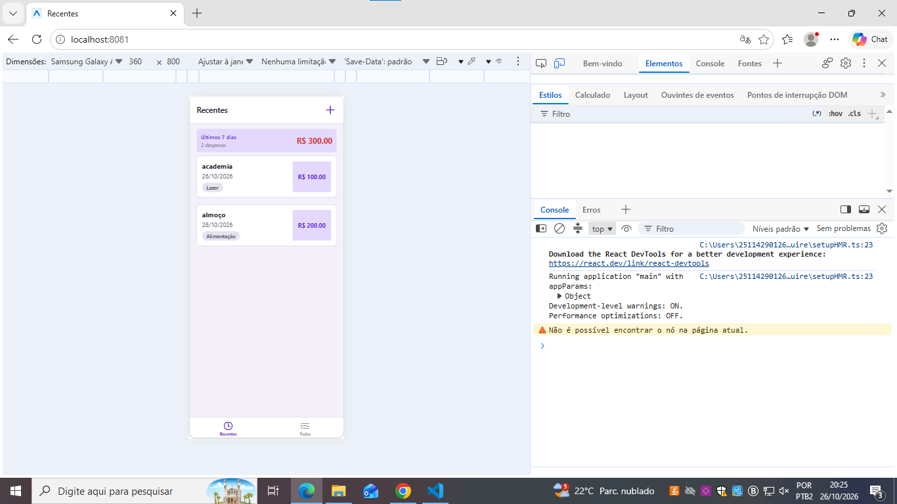
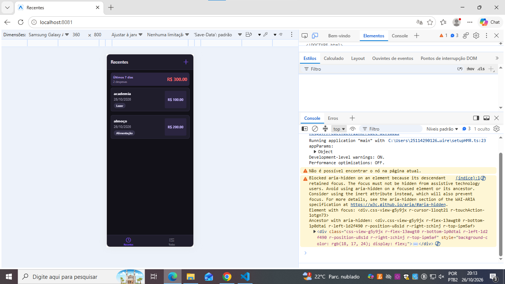
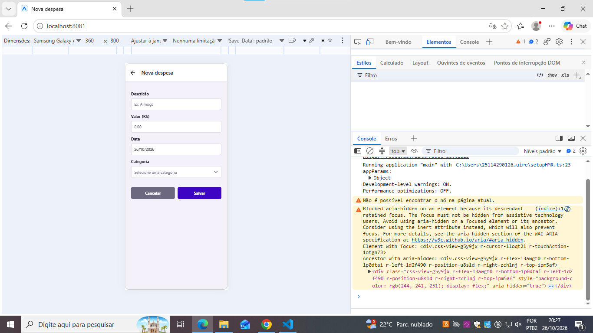

# 💸 Gerenciador de Despesas 2.0

Aplicativo de controle financeiro desenvolvido em **React Native (Expo)** como atividade prática da disciplina de Programação para Dispositivos Móveis (IESB).

Nesta versão, o app evoluiu de telas com listas isoladas para uma aplicação consistente, com **estado global**, **persistência de dados**, **formulário validado** e recursos de **UX** (busca, estado vazio, tema claro/escuro e adaptação por plataforma).

## ✨ Funcionalidades

- **Estado global** com Context API + `useReducer` (ações `ADD`, `UPDATE`, `DELETE` e `SET`)
- **Persistência** com AsyncStorage: os dados continuam após fechar e reabrir o app
- **Criar e editar na mesma tela**, via parâmetro de rota `expenseId`, com título dinâmico
- **Exclusão com confirmação** (`Alert.alert` com Cancelar/Excluir)
- **Formulário validado** com mensagens de erro abaixo de cada campo e borda vermelha nos campos inválidos
- **Categoria escolhida em Modal**, sem digitação livre
- **Busca por descrição** com debounce, sem diferenciar maiúsculas de minúsculas
- **Estado vazio** orientativo com ícone e mensagem
- **Sumário** com quantidade e total das despesas exibidas
- **Tema claro/escuro** automático, seguindo o sistema
- **Sombra por plataforma** (`Platform.select`: `shadow*` no iOS e `elevation` no Android)

### 🎁 Bônus implementados

- **Filtro por categoria** com chips, combinável com a busca (o total reflete os dois filtros)
- **Limpar tudo**, com confirmação, que dispara `SET` com lista vazia
- **Layout responsivo**: lista em 2 colunas quando a largura é maior que 600 (`useWindowDimensions`)

### Extra

- O total aparece em **vermelho** quando ultrapassa R$ 200,00 (herdado do bônus da atividade anterior)

## 🛠️ Tecnologias

- [React Native](https://reactnative.dev/) com [Expo](https://expo.dev/) (SDK 57)
- [React Navigation](https://reactnavigation.org/) (Native Stack + Bottom Tabs)
- [@react-native-async-storage/async-storage](https://react-native-async-storage.github.io/async-storage/)
- [@react-native-community/datetimepicker](https://github.com/react-native-datetimepicker/datetimepicker)
- [@expo/vector-icons](https://icons.expo.fyi/) (Ionicons)

> Sem bibliotecas de estado ou de formulário (Redux, Zustand, Formik, React Hook Form etc.): apenas Context API, `useReducer` e validação manual.

## 📁 Estrutura do projeto

```
Gerenciador-despesas-2.0/
├── App.js                            # navegação + Provider + tema do React Navigation
└── src/
    ├── components/
    │   └── despesa/
    │       ├── DespesaItem.js        # card da despesa (navega com expenseId, tema e sombra)
    │       ├── DespesaLista.js       # FlatList com ListEmptyComponent e 2 colunas responsivas
    │       ├── DespesaSaida.js       # junta sumário + lista (reutilizado nas duas telas)
    │       ├── DespesaSumario.js     # quantidade e total com .reduce()
    │       └── FiltroCategoria.js    # chips de filtro por categoria
    ├── constants/
    │   ├── categories.js             # lista CATEGORIES
    │   └── theme.js                  # cores dos modos claro e escuro
    ├── hooks/
    │   └── useDebounce.js            # hook de debounce com limpeza via clearTimeout
    ├── screens/
    │   ├── TodasDespesas.js          # busca (debounce + useMemo) + filtro + limpar tudo
    │   ├── DespesasRecentes.js       # despesas dos últimos 7 dias
    │   └── GerenciarDespesa.js       # formulário de criação/edição com validação
    ├── store/
    │   └── expenses-context.js       # Context + reducer + persistência + useExpenses()
    └── util/
        └── data.js                   # formatação e cálculo de datas
```

## 🧠 Como os requisitos foram atendidos

| Critério | Implementação | Onde está |
|---|---|---|
| **1. Estado global e persistência** | Reducer imutável com `ADD`, `UPDATE`, `DELETE`, `SET`; hook `useExpenses()` que lança erro fora do Provider; carregamento do AsyncStorage (`@expenses`) com `isLoaded`; salvamento a cada alteração com `try/catch` | `store/expenses-context.js` |
| **2. Navegação com parâmetros** | `expenseId` via `route.params`, `isEditing`, `navigation.setOptions` para o título, `Alert` de confirmação e `goBack()` | `DespesaItem.js`, `GerenciarDespesa.js` |
| **3. Formulário e validação** | Objeto único `form` + `handleChange` com spread; `validate()` com 4 regras; Regex `/^\d*\.?\d{0,2}$/`; `decimal-pad`; Modal de categoria; `KeyboardAvoidingView` + `ScrollView` | `GerenciarDespesa.js` |
| **4. Listas e busca** | `ListEmptyComponent`; sumário com quantidade e total; `useDebounce`; busca com `useMemo` refletindo no total | `DespesaLista.js`, `DespesaSumario.js`, `TodasDespesas.js`, `useDebounce.js` |
| **5. Tema e plataforma** | `theme.js` com os dois modos aplicado via `useColorScheme` em várias telas; sombra com `Platform.select` | `theme.js`, `DespesaItem.js` e demais telas |
| **6. Organização** | Estrutura modular, componentes reutilizados (`DespesaSaida` nas duas abas) | todo o projeto |

### Regras de validação

| Campo | Regra |
|---|---|
| Descrição | Mínimo de 3 caracteres |
| Valor | Maior que zero (máximo de 2 casas decimais) |
| Data | Não pode ser futura |
| Categoria | Obrigatória |

## 🚀 Como executar

### Pré-requisitos

- [Node.js](https://nodejs.org/) (versão LTS)
- App **Expo Go** no celular (Android ou iOS) ou um emulador configurado

### Passos

```bash
# 1. Clone o repositório e entre na pasta do projeto
git clone <url-do-repositorio>
cd praticas/Gerenciador-despesas-2.0

# 2. Instale as dependências
npm install

# 3. Inicie o projeto
npx expo start
```

Escaneie o QR code com o **Expo Go** (celular e computador na mesma rede Wi-Fi) ou pressione `a` para abrir no emulador Android.

> ⚠️ **Atenção:** no navegador (`w`), o `DateTimePicker` não funciona e o `Alert.alert` não exibe botões. Para testar o formulário completo, use o Expo Go ou um emulador.

## 🧪 Roteiro de testes

- [ ] Abrir o app sem dados: a lista mostra o estado vazio com ícone e orientação
- [ ] Salvar com todos os campos vazios: aparece uma mensagem abaixo de cada campo inválido
- [ ] Descrição `ab`, valor `0` e data de amanhã: aparecem as 3 mensagens correspondentes
- [ ] Corrigir a descrição: apenas a mensagem dela desaparece
- [ ] Com o teclado aberto, o botão Salvar continua visível ou acessível por rolagem
- [ ] Escolher a categoria no Modal e salvar: a despesa aparece em Todas e em Recentes
- [ ] Tocar na despesa: abre "Editar despesa" com os campos preenchidos
- [ ] Alterar o valor e salvar: o novo valor aparece nas duas abas e nos totais
- [ ] Excluir: Cancelar mantém a despesa; Excluir remove e volta para a lista
- [ ] Cadastrar 3 despesas, fechar o app por completo e reabrir: elas continuam na lista
- [ ] Buscar `ALM` em maiúsculas: filtra "Almoço" e atualiza quantidade e total
- [ ] Buscar um termo inexistente: exibe o estado vazio, sem erro
- [ ] Alternar o tema do sistema: as telas mudam de cores
- [ ] Observar o console: sem erros nem avisos de `key`

## 📸 Prints

### Lista (modo claro)


### Lista (modo escuro)


### Formulário com mensagens de erro


